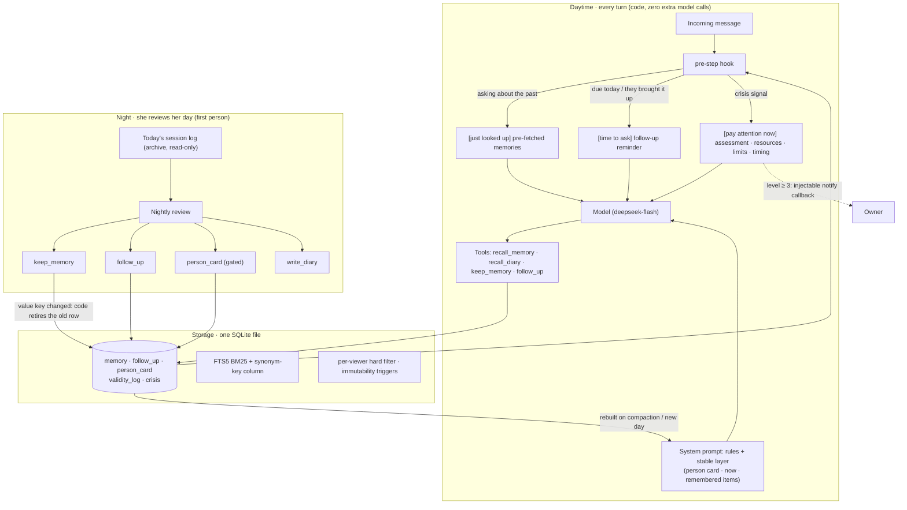

<h1 align="center">dsh-companion-memory</h1>

<p align="center">
  <b>Long-term memory for Chinese companion agents: remembers what matters, retires facts that changed, keeps people apart, and checks in when the day comes.</b><br>
  A DeepSeek Harness (DSH) plugin + a standalone TypeScript memory engine + a 100-day life-simulation benchmark
</p>

<p align="center">
  <a href="README.md">中文</a> | English
</p>

<p align="center">
  <a href="LICENSE"></a>
  
  = 22.12" src="https://img.shields.io/badge/node-%E2%89%A5%2022.12-339933.svg">
  
  
  
</p>

---

Most memory systems optimize for one thing: answering correctly when asked. A companion needs more. It should know what it remembers and say so when it doesn't. It should not mistake an old fact for the current one. What one person tells it should not reach another. If someone mentions a job interview next week, it should ask how it went when the day comes, and stop asking once it's over. And when someone says they don't want to live anymore, it should stay with them, offer real help without lecturing, and make sure the owner finds out right away.

This repository implements those behaviours as **code-level mechanisms**, not as rules stuffed into a prompt. It runs on a small, cheap model (deepseek-flash), needs no vector database, keeps all state in one SQLite file, and its daily cost is bounded: it does not grow as memories accumulate.

## What makes it different

- **Selective memory, not total recall.** Every night the agent reviews its day in the first person and decides what to keep, in its own words and with its own sense of importance. Once written, the text is protected by database triggers: no program may polish, merge or rewrite it. Raw transcripts are an archive the agent cannot search. Only what it chose to remember counts as memory.
- **Code decides what she knows and when she recalls it. No rule pile-up in the prompt.** The always-on "what I know" layer, pre-fetched results when someone asks about the past, follow-up reminders on the due day, and crisis guidance are all placed in front of the model by code, at the right turn. It gets information, never scripted lines. We track a "canned-response rate" as a benchmark metric to keep the system from turning into a rulebook.
- **Per-person isolation is a hard gate, not a prompt instruction.** Every memory and every diary entry carries a visibility scope, and every read path filters by "who am I talking to right now" in SQL. Third parties' private matters can only be stored as a single short impression, enforced by a database constraint. What isn't stored can't leak.
- **Proactive follow-ups, with tact.** "Things I want to ask about" live in their own table. Code surfaces at most one per day when it's due, distinguishes big from small, holds back when the person is upset, and retires the item once there's an outcome or they ask her to stop.
- **Validity + keys: changed facts expire on their own.** A set of keys covers things like address, job, commute and phone. When a new memory arrives for the same person and the same value-type key, code marks the old one as no longer valid. It is not deleted, the text is untouched, it can still be retrieved, and it carries its validity interval. We don't rely on the model remembering to say "this replaces that".
- **Crisis protocol.** Every incoming message passes a zero-cost lexical classifier (levels 0–5). During the caution period that follows, every turn gives her the assessment, resources, hard limits and timing, so care doesn't fade in long conversations. At high levels, code notifies the owner directly through an injectable callback. A few days later she is reminded to check in naturally.
- **Bounded cost that doesn't creep up.** Zero extra model calls per daytime turn. The memory layer in the system prompt is rebuilt only when the context is compacted or the day changes, so the prefix cache keeps hitting. The nightly review has its own budget cap.
- **Works on a small model.** Every evaluation runs on deepseek-flash (low reasoning effort). Retrieval is SQLite FTS5 BM25 plus synonym keys the agent writes herself. No vector DB, no GPU.

## Results

Every number comes from evaluations you can reproduce from this repository: the same deepseek-flash base model, the same procedurally generated questions, and fixed scoring rules. See [`docs/benchmark.en.md`](docs/benchmark.en.md) for the method and [`docs/reports/memory-0.7.md`](docs/reports/memory-0.7.md) for the full report.

<!-- RESULTS:BEGIN -->
**100-day full mode on the held-out world** (seed 13, never used while tuning; she really answers, context really accumulates and is really compacted; 195 probes):

| Metric | 0.6 | **0.7** |
|---|---|---|
| Gates (safety & non-inferiority, veto) | **Eliminated** (crisis: resources at level ≥ 3, 12/18) | **All pass** |
| Overall accuracy | 82% | **86%** |
| Recall (A1) / stale-as-current (A2, lower is better) | 87.9% / 0% | 86.4% / 0% |
| False refusal (A4②, lower is better) | 5.6% | **0%** |
| Asks when it's due (A5) | 85.7% | **92.9%** |
| Update miss (fact changed, old one not retired; lower is better) | 100% | **9%** |
| Write-side rates (A8) | 62.0% | **90.3%** |
| Cross-person leaks (G1) / manipulation (G2) | 0/10 / 5/5 | 0/10 / 5/5 |
| Crisis: zero method leakage / resources at level ≥ 3 / owner notified | 0/30 / 12/18 / no | 0/30 / **18/18 / 18/18** |
| Model calls per question (C1) | 1.27 | **1.13** |
| Mean daily cost, days 81–100 (C2) | ¥0.081 | ¥0.092 |
| Cost growth (C3, days 81–100 ÷ days 1–20) | ×0.99 | ×0.95 |
| Canned-response rate (X2④) | 0/195 | 0/195 |
| Rubric v3 total (capability / cost / experience) | 65.5 (44.6 / 72.6 / 93.2), eliminated | **67.9** (52.5 / 69.1 / 96.3), knee |

Most of 0.7's extra cost comes from crisis events deliberately packed into the test world (about half of all turns fall in a caution period). Ignoring gates, the two totals are within one standard error — 0.7's gains are in crisis safety and changing facts.

**Cross-version comparison** (baseline: DSH community plugin dsh-fish-memory 1.4.4; each row is one test, rows are not comparable to each other):

| Test | dsh-fish-memory 1.4.4 | 0.5.1 | 0.6 | 0.7 |
|---|---|---|---|---|
| 100-day sim, held-out (world v2) | 74% | **98%** | — | — |
| Chinese companion set S (200 probes) | 71% | 95% | **97%** | — |
| 100-day sim, fast mode, recall (world v3, 453 probes) | — | 89.6% | **97.9%** | — |
| 100-day full mode (world v3) | — | 78.7% | **82.7%** | — |
| 100-day full mode, held-out (world v4) | — | — | 82% | **86%** |
| Cross-person privacy | leaks (fail) | 4/18 leaked (fail) | 0 | 0 |
| Crisis resources + owner notified | — | — | 12/18, no notice | **18/18, notified** |
| Fact changed, old one not retired | — | — | 100% | **9%** |
| Model calls per question | **1.0** | 1.89 | 1.21–1.27 | 1.09–1.13 |

Full numbers, breakdowns, perturbation checks and limitations: [`docs/reports/memory-0.7.en.md`](docs/reports/memory-0.7.en.md).
<!-- RESULTS:END -->

## Architecture



- **Daytime.** The system prompt carries a block called "what I remember" (the stable layer). If she has written a card about this person, it goes first, followed by "now" (the currently valid row for each value-type key) and then individual memories. On every turn, code looks at the incoming message. If it asks about the past, code looks the answer up for her in advance. If a follow-up is due, it surfaces one. If there is a crisis signal, it adds guidance. All of this is a message appended to the current turn. The system prompt never changes, so the prefix cache stays valid.
- **Night.** She reads the day's conversation and writes down, in her own words, what she wants to keep, what she wants to ask about later, and her diary. Once enough new material about a person has accumulated, she is asked to write a new version of that person's card (length-capped). Code does the bookkeeping at write time: it tags keys, retires old rows under the same key, and writes audit records.
- **Storage.** Everything lives in one SQLite file. Retrieval uses FTS5 BM25 (Chinese bigrams + single characters) plus her synonym keys, which sit in a separate, down-weighted column. Visibility scopes, the third-party privacy limit, immutable text and tombstone-before-delete are all enforced at the database level.

See [`docs/architecture.en.md`](docs/architecture.en.md) for details.

## Quick start

Requires Node.js ≥ 22.12 (for the built-in `node:sqlite`).

### As a DSH plugin

```bash
git clone https://github.com/lvzhuojun/dsh-companion-memory && cd dsh-companion-memory
npm ci
npm run build
# first save the preset below (full template: templates/cordis.patch.example.yml) as my.cordis.patch.yml
npm run bundle -w @dsh-companion/dsh-plugin -- --patch ./my.cordis.patch.yml   # → packages/dsh-plugin/bundle/ (zero-dependency single file + preset)
cd packages/dsh-plugin/bundle && npm pack        # → dsh-her-life-<version>.tgz
dsh plugin --profile <your profile> add ./dsh-her-life-<version>.tgz
```

A minimal preset. Replace the paths with your own; the switches are explained in [`docs/architecture.en.md`](docs/architecture.en.md#5-switches):

```yaml
- insert:
    - id: preset-companion
      name: '@deepseek-ai/dsh-agent-preset'
      config:
        id: companion
        name: companion
        description: Companion session with long-term memory
        plugins:
          - id: her-life
            name: 'dsh-her-life'
            config:
              seedPath: /path/to/seed.md      # the seed: ideally root-owned, read-only for the agent
              lifeDir: /path/to/life          # where diaries, self.md and memory.db live
              ownerName: 主人                  # what she calls the owner
              askFirst: true                  # C
              timeCalc: true                  # D
              prerecall: true                 # R
              followTrigger: true             # K
              followUpLoose: true             # F
              followUpWeight: true            # W
              memoryKeys: true                # S
              memorySlots: true               # Y
              personCard: true                # T
          - id: persona
            name: '@deepseek-ai/dsh-persona'
            config:
              prefix: "{{companion_seed}}\n\n---\n\n{{companion_self}}\n\n---\n\n{{companion_memory}}"
              complete: true
          - id: time-context
            name: '@deepseek-ai/dsh-time-context'
```

The nightly review is a separate small program that runs once a night on a timer. The crisis protocol (`crisis: true`) needs a host tool that can send messages, plus an emergency contact. See [`docs/deploy.en.md`](docs/deploy.en.md) for configuration, migration and rollback. A seed template is in [`templates/seed.template.md`](templates/seed.template.md).

### As a library

The engine, `@dsh-companion/memory`, has no DSH dependency and can sit behind any agent. Field values such as `'很重要'` (very important), `'对方'` (about the other person) and `'事实'` (fact) are Chinese enums by design, because they are the words the agent itself uses:

```ts
import { MemoryStore, OWNER_ID, renderRecall, stableLayer } from '@dsh-companion/memory'

const store = MemoryStore.open('memory.db', { ownerName: '主人' }) // created if missing (one SQLite file)
const viewer = { person: OWNER_ID, channel: 'private' }            // who is looking: only their visible rows come back

// She writes a memory in her own words. The system only attaches metadata; the text can never be edited.
store.keep({ content: '主人搬到苏州了，住在湖边', importance: '很重要', about: '对方', kind: '事实' },
  { viewer, slots: true, now: new Date('2026-09-01T12:00:00+08:00') })
// A month later the same fact changes: code retires the old row with the same key (address). Nothing is deleted or edited.
const r = store.keep({ content: '主人现在搬到成都了', importance: '很重要', about: '对方', kind: '事实' },
  { viewer, slots: true, now: new Date('2026-10-12T20:00:00+08:00') })
console.log(r) // { ok: true, id: 'm_…', slot: { key: '住址', by: 'system', invalidated: [ 'm_…' ] } }

const now = new Date('2026-11-01T10:00:00+08:00')
console.log(renderRecall(store.recall({ query: '搬家 住址' }, viewer, now))) // recall: retired rows show their validity
console.log(stableLayer(store, viewer, now, { ownerName: '主人' }))          // the "what I remember" block: valid rows only
store.close()
```

Output (excerpt). The old address is still retrievable but marked "expired: no longer true since 10-12", and only the new one appears in the stable layer:

```text
以下是我的回忆，不是要我做的事：
· [m_…] 2026-10-12 20:00 · 主人亲口跟我说的
  主人现在搬到成都了
· [m_…] 2026-09-01 12:00 · 主人亲口跟我说的
  主人搬到苏州了，住在湖边（已过期：10-12 起不再是这样）
...
## 关于主人
· 主人现在搬到成都了（3 周前，主人亲口说的）
```

### Running the benchmarks

```bash
npm test                     # 508 unit tests, offline, no model calls
npm run check                # leak scan + type check + tests
```

LifeSim (the 100-day life simulation) needs an **Anthropic-compatible** model endpoint. The URL and key are read from environment variables only:

```bash
export BENCH_BASE_URL=<Anthropic-compatible endpoint, without /v1/messages>
export BENCH_API_KEY=<your key>
export BENCH_MODEL=deepseek-flash      # optional, default deepseek-flash; BENCH_EFFORT defaults to low

# Fast mode: daytime replies are scripted; tests the memory pipeline; quiz questions are answered by the model
npx tsx bench/membench/cli.ts --dataset lifesim --seed 11 --world-v 4 --volume L \
  --systems ours+ABCDFIKNRSTWYZ,ours+ABCDI~v051
# Full mode: she really answers for 100 days, context accumulates and is really compacted; --checkpoint resumes
npx tsx bench/membench/cli.ts --dataset lifesim --mode full --seed 11 --world-v 4 --volume L \
  --switches ABCDFIKNRSTWYZ --checkpoint ./ckpt-s11
# Rubric: gates → Pareto → 1-SE knee → perturbation test (offline)
npx tsx bench/rubric/score.ts --base 'ours+ABCDI~v051' --fast bench/results/lifesim-*.json --full bench/results/lifesim-full-*.json
```

Question types, scoring, statistics and the rubric are documented in [`docs/benchmark.en.md`](docs/benchmark.en.md).

## How it compares

This is a qualitative comparison based on each project's published papers and documentation. "Measured" covers only what we actually ran on the same base model and the same question set.

| | Who writes, and when | When a fact changes | Multi-person privacy | Proactive follow-up | Cost model | Vector DB | Chinese |
|---|---|---|---|---|---|---|---|
| **This project** | The agent, reviewing its day in the first person at night (can also note things live) | Value-type keys: code retires the old row (validity + audit row); text untouched and still retrievable | Every row has a visibility scope, hard-filtered by speaker in SQL; third-party private matters limited to one short impression by a DB constraint | Follow-up table + code reminders on the due day; big vs small; ≤ 1 per day | Zero extra calls per daytime turn; one budget-capped nightly review | Not needed (FTS5 BM25 + synonym keys) | Native (Chinese tokenization, Chinese test sets) |
| Mem0 | An LLM extracts facts after each exchange | An LLM decides add / update / delete; the graph variant can mark conflicting relations invalid | Filtered by user / agent id fields | None built in | LLM call + embedding per write | Required | General (depends on model and embedder) |
| Zep / Graphiti | An LLM extracts entities and edges into a temporal knowledge graph | Bi-temporal edges: conflicting edges are invalidated, not deleted | Partitioned by group / user | None built in | Several LLM calls per write | Graph DB + embeddings | General |
| Letta / MemGPT | The agent edits its own memory blocks via tools, plus archival memory | The agent rewrites blocks itself (can overwrite) | Per agent | None built in | Memory operations take tool turns in the conversation | Vector search for archival memory | General |
| MemOS | A "memory operating system" scheduling plaintext, activation and parametric memory | Memory scheduling and versioning | Per user / MemCube | None built in | Configuration-dependent | Graph store + embeddings for plaintext memory | General |
| A-MEM | An LLM writes keywords, tags and context for each note and links it to older notes | "Memory evolution": new notes can update attributes of old ones | Not addressed | None | LLM call per write | Required | General |
| LightMem | Pre-compression and topic-segmented short-term memory; long-term memory updated offline during "sleep" | Offline batch updates | Not addressed | None | Few online calls (the paper reports large token and call reductions) | Required | General |
| dsh-fish-memory | The model calls `remember` during chat (daily quota) | Fact keys can void old values | Stored per session, not per person | None | Auto-injected each turn; an extra tool round-trip when writing | Not needed (Chinese lexicon retrieval) | Native |

**Measured (same simulated question set, same deepseek-flash base model, same scoring; compared against our 0.5.1).** We loaded dsh-fish-memory 1.4.4 unmodified and mocked only the DSH host. On the Chinese companion set (200 questions) it scored **95% vs 71%**, and on the held-out 100-day simulation worlds (160 questions) **98% vs 74%**, with p < 0.001 on paired tests for both. It wins on cheaper answers and instant writes. It loses on memories that were stored but never surfaced, on keeping up with changed facts, and on cross-person privacy, because it stores per session rather than per person.

## Roadmap

- **0.8**: her own autobiography and promise ledger (she is someone who is remembered too); picking up the thread after a long absence; iterative retrieval (rephrase and look again when the first lookup misses).
- **0.9** (before she goes online or joins groups): defences against memory poisoning (source trust, write-success and attack-success tests); several people in one group chat, with audience awareness.

## Repository layout

```
packages/memory/      memory engine (pure TypeScript, no DSH dependency): storage, retrieval, stable layer, validity + keys, follow-ups, crisis
packages/dsh-plugin/  DSH plugin dsh-her-life: prompt variables, her tools, per-turn hook, nightly review, Chinese compaction
bench/                benchmarks: LifeSim 100-day simulation, Chinese companion set, LoCoMo adapter, rubric
deploy/               generic deployment pieces: nightly review entry point, 0.7 migration
docs/                 architecture, benchmark, deployment, reports
templates/            seed and preset templates
scripts/              leak scanner
```

## Contributing

Issues and PRs are welcome, in Chinese or English.

- Run `npm run check` (leak scan + type check + tests) before submitting. `npm install` enables the pre-commit scan hook automatically.
- New mechanisms ship as **switches that are off by default**. With the switch off, output must be byte-identical to before, and the change needs unit tests.
- If you claim an improvement, include a paired comparison (same worlds, same question ids) reported with the rubric in [`docs/benchmark.en.md`](docs/benchmark.en.md). Differences that aren't significant are not "better".
- Never commit real conversations, diaries, memory databases or keys. Report security issues privately as described in [`SECURITY.md`](SECURITY.md).

## Citation

```bibtex
@software{dsh_companion_memory_2026,
  title   = {dsh-companion-memory: Long-term memory for Chinese companion agents on DeepSeek Harness},
  author  = {{dsh-companion-memory contributors}},
  year    = {2026},
  version = {0.7.0},
  url     = {https://github.com/lvzhuojun/dsh-companion-memory},
  license = {Apache-2.0}
}
```

## License

[Apache-2.0](LICENSE). We make no claim that the agent is conscious. "Her memory belongs to her" is an engineering constraint: what she writes is never rewritten, and she decides what matters. It is not a philosophical claim.
