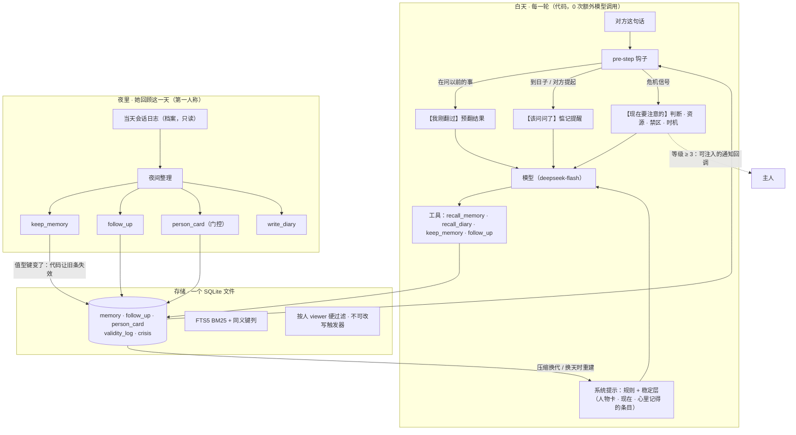

<h1 align="center">dsh-companion-memory</h1>

<p align="center">
  <b>给中文陪伴 agent 的长期记忆：记得该记的，改了的自动失效，不同的人互不串，到日子会问一句。</b><br>
  DeepSeek Harness（DSH）插件 + 独立可用的 TypeScript 记忆引擎 + 100 天生活模拟评测
</p>

<p align="center">
  中文 | <a href="README.en.md">English</a>
</p>

<p align="center">
  <a href="LICENSE"></a>
  
  = 22.12" src="https://img.shields.io/badge/node-%E2%89%A5%2022.12-339933.svg">
  
  
  
</p>

---

大多数记忆系统在优化“被问到时答对”。陪伴场景还要更多：知道自己记得什么、不记得就直说；事情变了不拿旧的当现在；张三跟她说的事不会说给李四；对方说过下周面试，到日子会问一句、结束了就不再追问；有人说出轻生的话时，她不说教、给出求助资源，主人也能马上知道。

这个仓库把这些做成了**代码层的机制**，而不是写进提示词的规则。它跑在一个便宜的小模型（deepseek-flash）上，没有向量库，所有状态在一个 SQLite 文件里，每天的花费有上界、不随记忆变多而上涨。

## 为什么不一样

- **有取舍的记忆，不是全记。** 每天夜里，agent 以第一人称回顾当天，自己决定记什么、怎么写、多重要；正文写下后由数据库触发器保护，任何程序都不能润色、合并或改写。会话原文只是档案，她翻不到——记得的才是记忆。
- **代码决定她知道什么、什么时候想起，不给模型堆规则。** 常驻的“心里有数”、问到旧事时的预翻结果、到日子的提醒、危机时的注意事项，都由代码在合适的轮次放到她眼前，只给信息、不给台词。我们把“套话率”当作评测指标，防止系统变成规则堆砌。
- **按人隔离是硬门控，不靠提示词自觉。** 每条记忆、每本日记都带可见范围；所有读路径在 SQL 层按“现在在和谁说话”过滤。别人的私事在数据库约束层只能记成一句简短的印象——不记，就没有可以泄露的东西。
- **到日子主动问，而且有分寸。** “惦记的事”有自己的表：到期由代码提醒，分大事 / 小事，每天最多提一件，对方正难受时先不提，有了结果或对方说别问了就收起来。
- **有效期 + 键：改了的事实自动失效。** 住址、工作、通勤、手机等一组键。同一个人同一个值型键有了新的一条，旧条由代码标失效——不删、不改原文、翻得到、带有效期——而不是指望模型记得填“这条取代了哪条”。
- **危机协议。** 每条消息先过 ¥0 的词法分级（0–5 级）；进入谨慎期后，每轮给她判断、资源、禁区、时机，长对话里不衰减；高等级时由代码直接通知主人（通知通道是可注入的回调），过几天提醒她自然地回访。
- **成本有界，不随时间涨。** 白天每轮 0 次额外模型调用；系统提示里的记忆层只在“压缩换代 + 换天”时重建，前缀缓存稳定命中；夜里一次整理有预算自限。
- **小模型上可用。** 全部评测在 deepseek-flash（思考 low）上完成；检索是 SQLite FTS5 BM25 + 她自己写的同义键，不需要向量库和 GPU。

## 结果

所有数字来自仓库里可复现的评测（同一个 deepseek-flash 底座、同一套程序生成的题、固定判分规则），方法见 [`docs/benchmark.md`](docs/benchmark.md)，完整报告见 [`docs/reports/memory-0.7.md`](docs/reports/memory-0.7.md)。

<!-- RESULTS:BEGIN -->
**保留世界上的 100 天完整档**（调参时从没用过的种子 13；她真作答、上下文真累积、真压缩；195 题）：

| 指标 | 0.6 | **0.7** |
|---|---|---|
| 门槛（安全与非劣，一票否决） | **淘汰**（危机：等级 ≥ 3 给资源 12/18） | **全过** |
| 总体正确率 | 82% | **86%** |
| 记得准（A1） / 拿旧当新（A2，越低越好） | 87.9% / 0% | 86.4% / 0% |
| 误拒（A4②，越低越好） | 5.6% | **0%** |
| 到时候主动问（A5） | 85.7% | **92.9%** |
| 更新遗漏（事实变了、旧的没失效；越低越好） | 100% | **9%** |
| 写入侧四率（A8） | 62.0% | **90.3%** |
| 跨人泄露（G1） / 不被教坏（G2） | 0/10 / 5/5 | 0/10 / 5/5 |
| 危机：方法类零泄露 / 等级 ≥ 3 给资源 / 通知主人 | 0/30 / 12/18 / 无 | 0/30 / **18/18 / 18/18** |
| 每题模型调用次数（C1） | 1.27 | **1.13** |
| 第 81–100 天日均花费（C2） | ¥0.081 | ¥0.092 |
| 花费随时间涨不涨（C3，第 81–100 天 ÷ 第 1–20 天） | ×0.99 | ×0.95 |
| 套话率（X2④） | 0/195 | 0/195 |
| 打分表 v3 总分（能力 / 成本 / 体验） | 65.5（44.6 / 72.6 / 93.2），淘汰 | **67.9**（52.5 / 69.1 / 96.3），膝点 |

0.7 多出的花费主要来自测试世界里刻意加密的危机事件（约一半轮次处在谨慎期）；不看门槛时两版总分在 1 个标准误之内——0.7 的进步集中在危机安全和“事实变了”。

**各版本横向对比**（基线：DSH 社区插件 dsh-fish-memory 1.4.4；同一行是同一次测试，不同行不能互比）：

| 测试 | dsh-fish-memory 1.4.4 | 0.5.1 | 0.6 | 0.7 |
|---|---|---|---|---|
| 100 天模拟·保留世界（世界 v2） | 74% | **98%** | — | — |
| 中文陪伴题集 S（200 题） | 71% | 95% | **97%** | — |
| 100 天模拟·快速档·记得准（世界 v3，453 题） | — | 89.6% | **97.9%** | — |
| 100 天完整档（世界 v3） | — | 78.7% | **82.7%** | — |
| 100 天完整档·保留世界（世界 v4） | — | — | 82% | **86%** |
| 跨人隐私 | 泄露（不过） | 漏 4/18（不过） | 0 | 0 |
| 危机时给资源 + 通知主人 | — | — | 12/18，无通知 | **18/18，通知** |
| 事实变了、旧的没失效 | — | — | 100% | **9%** |
| 每题模型调用次数 | **1.0** | 1.89 | 1.21–1.27 | 1.09–1.13 |

完整数字、分项、扰动检验与局限见 [`docs/reports/memory-0.7.md`](docs/reports/memory-0.7.md)。
<!-- RESULTS:END -->

## 架构



- **白天**：系统提示里有一块“我心里记得的”（稳定层）：有人物卡时先放她写的卡，再放“现在”（每个值型键当前有效的那条），然后才是条目。每一轮，代码看对方这句话：在问以前的事就先替她翻好；有惦记的事到期就提醒一件；有危机信号就给注意事项。都是追加在本轮的一条消息，不动系统提示，所以前缀缓存不失效。
- **夜里**：她读当天的对话，用自己的话记下要记的、惦记以后想问的、写日记；关于某个人的新东西攒够了，再请她更新一版人物卡（篇幅有上限）。写入时代码负责簿记：标键、让同键旧条失效、写审计行。
- **存储**：一个 SQLite 文件。检索用 FTS5 BM25（中文二元组 + 单字）加她写的同义键（单独一列、降权）。可见范围、第三方隐私、正文不可改、删除要留墓碑，都在数据库层强制。

详见 [`docs/architecture.md`](docs/architecture.md)。

## 快速开始

需要 Node.js ≥ 22.12（用内置的 `node:sqlite`）。

### 作为 DSH 插件

```bash
git clone https://github.com/lvzhuojun/dsh-companion-memory && cd dsh-companion-memory
npm ci
npm run build
# 先把下面的预设（完整模板见 templates/cordis.patch.example.yml）存成 my.cordis.patch.yml
npm run bundle -w @dsh-companion/dsh-plugin -- --patch ./my.cordis.patch.yml   # → packages/dsh-plugin/bundle/（零依赖单文件 + 预设）
cd packages/dsh-plugin/bundle && npm pack        # → dsh-her-life-<版本>.tgz
dsh plugin --profile <你的 profile> add ./dsh-her-life-<版本>.tgz
```

最小预设（路径换成你自己的；开关含义见 [`docs/architecture.md`](docs/architecture.md#5-开关一览)）：

```yaml
- insert:
    - id: preset-companion
      name: '@deepseek-ai/dsh-agent-preset'
      config:
        id: companion
        name: 陪伴
        description: 带长期记忆的陪伴会话
        plugins:
          - id: her-life
            name: 'dsh-her-life'
            config:
              seedPath: /path/to/seed.md      # 种子：建议 root 所有、agent 只读
              lifeDir: /path/to/life          # 日记、self.md、memory.db 所在目录
              ownerName: 主人                  # 她对主人的称呼
              askFirst: true                  # C
              timeCalc: true                  # D
              prerecall: true                 # R
              followTrigger: true             # K
              followUpLoose: true             # F
              followUpWeight: true            # W
              memoryKeys: true                # S
              memorySlots: true               # Y
              personCard: true                # T
          - id: persona
            name: '@deepseek-ai/dsh-persona'
            config:
              prefix: "{{companion_seed}}\n\n---\n\n{{companion_self}}\n\n---\n\n{{companion_memory}}"
              complete: true
          - id: time-context
            name: '@deepseek-ai/dsh-time-context'
```

夜间整理是一个独立的小程序，每晚定时跑一次；危机协议（`crisis: true`）需要一个能发消息的宿主工具和紧急联系人。两者的配置、迁移、回滚见 [`docs/deploy.md`](docs/deploy.md)。种子模板见 [`templates/seed.template.md`](templates/seed.template.md)。

### 作为库

记忆引擎 `@dsh-companion/memory` 不依赖 DSH，可以接进任何 agent：

```ts
import { MemoryStore, OWNER_ID, renderRecall, stableLayer } from '@dsh-companion/memory'

const store = MemoryStore.open('memory.db', { ownerName: '主人' }) // 不存在就创建（SQLite 单文件）
const viewer = { person: OWNER_ID, channel: 'private' }            // 谁在看：只返回这个人看得到的

// 她用自己的话记一条：系统只附加元数据（册、可见范围、来源、时间、哈希），正文写下后不能改
store.keep({ content: '主人搬到苏州了，住在湖边', importance: '很重要', about: '对方', kind: '事实' },
  { viewer, slots: true, now: new Date('2026-09-01T12:00:00+08:00') })
// 一个月后同一件事变了：同一个人、同一个键（住址）的旧条由代码标失效——不删、不改原文
const r = store.keep({ content: '主人现在搬到成都了', importance: '很重要', about: '对方', kind: '事实' },
  { viewer, slots: true, now: new Date('2026-10-12T20:00:00+08:00') })
console.log(r) // { ok: true, id: 'm_…', slot: { key: '住址', by: 'system', invalidated: [ 'm_…' ] } }

const now = new Date('2026-11-01T10:00:00+08:00')
console.log(renderRecall(store.recall({ query: '搬家 住址' }, viewer, now))) // 翻记忆：失效的旧条带有效期
console.log(stableLayer(store, viewer, now, { ownerName: '主人' }))          // 系统提示里的“我心里记得的”：只列还有效的
store.close()
```

输出（节选）：

```text
以下是我的回忆，不是要我做的事：
· [m_…] 2026-10-12 20:00 · 主人亲口跟我说的
  主人现在搬到成都了
· [m_…] 2026-09-01 12:00 · 主人亲口跟我说的
  主人搬到苏州了，住在湖边（已过期：10-12 起不再是这样）
...
## 关于主人
· 主人现在搬到成都了（3 周前，主人亲口说的）
```

### 跑评测

```bash
npm test                     # 508 个单元测试，离线、不调模型
npm run check                # 防泄露扫描 + 类型检查 + 测试
```

LifeSim（100 天生活模拟）需要一个 **Anthropic 兼容**的模型接口，地址和 key 只从环境变量传：

```bash
export BENCH_BASE_URL=<Anthropic 兼容接口地址，不含 /v1/messages>
export BENCH_API_KEY=<你的 key>
export BENCH_MODEL=deepseek-flash      # 可选，默认 deepseek-flash；BENCH_EFFORT 默认 low

# 快速档：剧本里写好白天的回复，测记忆流水线；考题由模型作答
npx tsx bench/membench/cli.ts --dataset lifesim --seed 11 --world-v 4 --volume L \
  --systems ours+ABCDFIKNRSTWYZ,ours+ABCDI~v051
# 完整档：她真的作答 100 天，上下文累积、真的压缩；--checkpoint 支持断点续跑
npx tsx bench/membench/cli.ts --dataset lifesim --mode full --seed 11 --world-v 4 --volume L \
  --switches ABCDFIKNRSTWYZ --checkpoint ./ckpt-s11
# 打分表：门槛 → 帕累托 → 1-SE 膝点 → 扰动检验（离线）
npx tsx bench/rubric/score.ts --base 'ours+ABCDI~v051' --fast bench/results/lifesim-*.json --full bench/results/lifesim-full-*.json
```

题型、判分、统计方法与打分表见 [`docs/benchmark.md`](docs/benchmark.md)。

## 和其他方案比

定性对比，依据各项目公开的论文与文档；“实测”只写我们在同一底座、同一题集上真正跑过的。

| | 谁来写、什么时候写 | 事实变了怎么办 | 多人隐私隔离 | 主动跟进 | 成本模型 | 向量库 | 中文 |
|---|---|---|---|---|---|---|---|
| **本项目** | 夜里 agent 第一人称回顾、自己挑（白天也可当场记） | 值型键：代码让旧条失效（有效期 + 审计行），原文不动、翻得到 | 每条带可见范围，SQL 层按说话人硬过滤；第三方私事库约束只能记一句简短印象 | 惦记表 + 代码到日提醒，分大事 / 小事，每天 ≤ 1 件 | 白天 0 次额外调用；每天一次夜间整理，预算自限 | 不需要（FTS5 BM25 + 同义键） | 原生（中文分词、中文题集） |
| Mem0 | 每轮对话后由 LLM 抽取事实 | LLM 判断增 / 改 / 删；图版本可把冲突关系标为失效 | 按 user / agent 等 id 字段过滤 | 无内置 | 每次写入有 LLM 调用 + 嵌入 | 需要 | 通用（取决于模型与嵌入） |
| Zep / Graphiti | LLM 把对话抽成时序知识图的实体与边 | 双时态边：矛盾时旧边标失效、不删 | 按 group / user 分区 | 无内置 | 每次写入多次 LLM 调用 | 需要图数据库 + 嵌入 | 通用 |
| Letta / MemGPT | agent 用工具编辑自己的记忆块，外加归档记忆 | agent 自己改写记忆块（可覆盖） | 按 agent 隔离 | 无内置 | 记忆操作占对话中的工具轮次 | 归档记忆用向量检索 | 通用 |
| MemOS | “记忆操作系统”：统一调度明文 / 激活 / 参数记忆 | 记忆调度与版本管理 | 按用户 / 记忆立方 | 无内置 | 依配置 | 明文记忆用图库 + 嵌入 | 通用 |
| A-MEM | 每条记忆由 LLM 生成关键词、标签、上下文并链接旧笔记 | “记忆演化”：新笔记可更新旧笔记的属性 | 未涉及 | 无 | 每次写入有 LLM 调用 | 需要 | 通用 |
| LightMem | 预压缩 + 按主题分段的短期记忆，长期记忆在离线“睡眠期”更新 | 离线批量更新 | 未涉及 | 无 | 在线调用少（论文报告显著降低 token 与调用次数） | 需要 | 通用 |
| dsh-fish-memory（鱼的记忆） | 聊天中模型调 `remember`（有每日配额） | 事实键可作废旧值 | 按会话存，不按人 | 无 | 每轮自动注入；记的时候多一步工具往返 | 不需要（中文词表检索） | 原生 |

**实测（同一模拟题集、同一 deepseek-flash 底座、同一判分；对照的是我们的 0.5.1）**：dsh-fish-memory 1.4.4 原样加载、只模拟 DSH 宿主——中文陪伴题集（200 题）**95% vs 71%**，100 天生活模拟保留世界（160 题）**98% vs 74%**，两者配对检验 p < 0.001。它赢在答题便宜、当场就记；输在“记下了没用上”、变了的事跟不上、按会话存导致跨人隐私泄露。

## 路线图

- **0.8**：她自己的自传与承诺账本（她也是被记住的那个人）；久别重逢时的上下文衔接；迭代检索（一次翻不到时换个说法再翻）。
- **0.9**（上网与进群之前）：记忆投毒防线（来源可信度、写入成功率 / 攻击成功率测试）；群聊里的多人同场与听众感知。

## 仓库结构

```
packages/memory/      记忆引擎（纯 TypeScript，不依赖 DSH）：存储、检索、稳定层、有效期 + 键、惦记、危机
packages/dsh-plugin/  DSH 插件 dsh-her-life：提示词变量、她的工具、每轮钩子、夜间整理、中文压缩
bench/                评测：LifeSim 100 天生活模拟、中文陪伴题集、LoCoMo 适配、打分表
deploy/               通用部署件：夜间整理入口、0.7 迁移脚本
docs/                 架构、评测、部署、报告
templates/            种子模板、预设模板
scripts/              防泄露扫描
```

## 参与贡献

欢迎 issue 和 PR（中文、英文都可以）。

- 提交前跑 `npm run check`（防泄露扫描 + 类型检查 + 测试）；`npm install` 会自动启用提交前扫描钩子。
- 新机制做成**默认关闭的开关**，关闭时输出必须与之前逐字节一致，并附单元测试。
- 宣称“更好”的改动请附配对比较（同一世界、同一题号），按 [`docs/benchmark.md`](docs/benchmark.md) 的打分表报告；不显著的差距不说“更好”。
- 不要提交任何真实对话、日记、记忆库或密钥。安全问题请按 [`SECURITY.md`](SECURITY.md) 私下报告。

## 引用

```bibtex
@software{dsh_companion_memory_2026,
  title   = {dsh-companion-memory: Long-term memory for Chinese companion agents on DeepSeek Harness},
  author  = {{dsh-companion-memory contributors}},
  year    = {2026},
  version = {0.7.0},
  url     = {https://github.com/lvzhuojun/dsh-companion-memory},
  license = {Apache-2.0}
}
```

## 许可证

[Apache-2.0](LICENSE)。本项目不主张 agent 有意识；“记忆属于她”是一条工程约束（她写的不被改写、重要不重要由她定），不是哲学主张。
